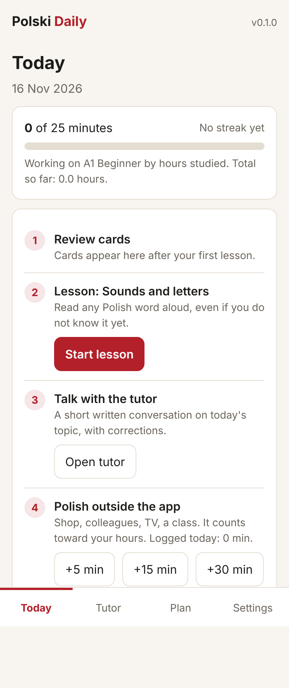

# Polski Daily

**A daily Polish study app for adults whose first language is not Slavic, with lessons that compare Polish to Greek, Italian or Spanish, a plan that shows when you will reach each level at your real pace, and an AI tutor on the Claude API.**

Live demo: [add the Render URL after the first deploy] · Current version: **v0.1.0** ([changelog](CHANGELOG.md))

## Why this exists

I am Greek, I live in Kraków, and I want to speak Polish. Most beginner material is written either for English speakers or for mixed classes where Ukrainian and Czech speakers move much faster because their languages are close to Polish. I wanted to test two ideas. First, that grammar notes written against the learner's own language (Greek already has cases and three genders, Italian and Spanish do not) make early Polish easier. Second, that a plan based on hours actually studied is more useful than a streak counter, because it tells you the date you will reach a level and how many minutes a day your goal really needs.

## What's inside

| Screen | What it does |
|---|---|
| Today | The daily session: review cards, the next lesson, a tutor conversation, and a log for Polish used outside the app |
| Lesson | Short explanation, a note for speakers of your language, examples, words, then 6 practice questions |
| Review | Flashcards from finished lessons on a spaced schedule (1, 2, 4, 8, 16 days) |
| Tutor | Written conversation in Polish at your level, with the main mistake corrected and explained in your language or English |
| Plan | Hours studied, real pace, projected date for A1 to B2, minutes a day your goal needs, and the topic list per level |
| Settings | Language, goal, daily minutes, backup download and restore |

## How it works

- `index.html` is the whole front end. No framework and no build step.
- `server.js` (Node and Express) serves the page and the lessons, and passes tutor messages to the Claude API so the API key never reaches the browser.
- `data/curriculum.json` holds the levels, hour targets and the 10 lessons, each with notes for Greek, Italian, Spanish and English speakers.
- Progress is saved in the browser's local storage. There are no accounts and the server stores nothing about learners.

## Run it locally

1. Install Node 18 or newer.
2. Run `npm install`, then `npm start`.
3. Open `http://localhost:3000`.

The tutor needs these environment variables (see `.env.example`): `ANTHROPIC_API_KEY`, and `ACCESS_CODE` if you want to limit who can use it. Without a key the rest of the app still works.

## Product documentation

- [Product brief](docs/product-brief.md)
- [Case study](docs/case-study.md)
- Decision records: [0001 browser storage](docs/decisions/0001-save-progress-in-the-browser.md), [0002 tutor access code](docs/decisions/0002-put-the-tutor-behind-an-access-code.md), [0003 English interface with language notes](docs/decisions/0003-keep-the-interface-in-english-with-per-language-notes.md)
- [Changelog](CHANGELOG.md)
- [Versioning](docs/versioning.md)

## Status and limits

- Version 0.1.0 has 10 lessons, all at the start of A1. The topic lists for A2 to B2 are a roadmap, not finished lessons.
- The hour targets per level (80, 180, 400, 800) are my planning estimates. They are not official figures and have not been checked against learner data yet.
- A level shown in the app is counted from hours studied. It is not a test result.
- The lessons and language notes were written with Claude and have not yet been reviewed by a Polish teacher or by native Italian and Spanish speakers.
- The tutor was tested against a stand-in for the Claude API. Its real answers still need checking after the first deploy.
- Progress does not sync between devices. Use the backup in Settings to move it.
- There is no audio yet, so the app does not train listening or speaking.
